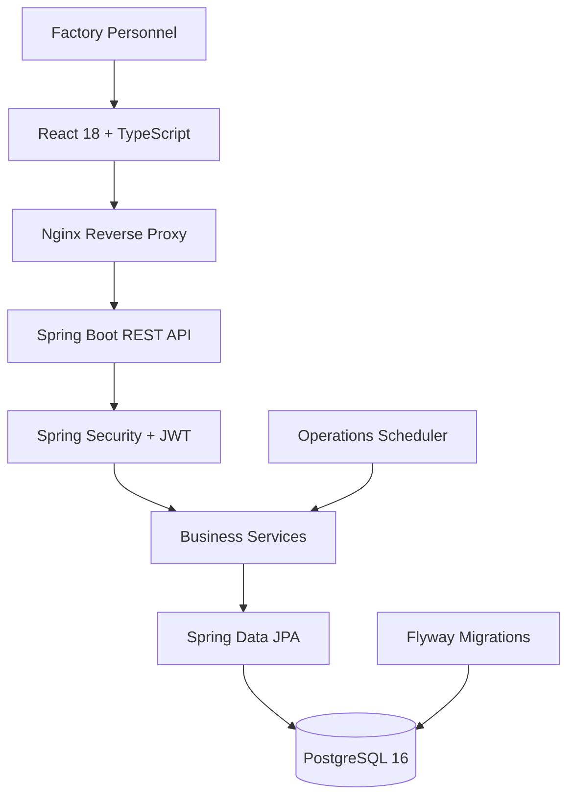
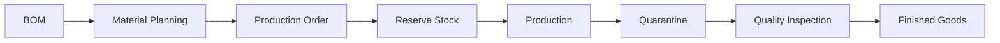

# 🏭 ManufactureOS

<p align="center">
  
</p>

<p align="center">
  <strong>THE OPERATING SYSTEM FOR MODERN MANUFACTURING</strong>
  <br />
  Plan production. Control inventory. Monitor quality. Optimize factory operations.
</p>

<p align="center">
  <a href="#-features">Features</a> •
  <a href="#-architecture">Architecture</a> •
  <a href="#-screenshots">Screenshots</a> •
  <a href="#-quick-start">Quick Start</a> •
  <a href="#-verification-status">Verification</a>
</p>

<p align="center">
  
  
  
  
  
  
</p>

---

## ⚡ The Factory Control Center

ManufactureOS is a manufacturing execution and management platform that connects production planning, material requirements, inventory, machine scheduling, workforce assignments, quality assurance, and purchasing in one centralized application.

<table>
  <tr>
    <td width="50%">
      <h3>⚙️ Production Intelligence</h3>
      Plan production orders, calculate material shortages, coordinate resources, and track output.
    </td>
    <td width="50%">
      <h3>📦 Inventory Integrity</h3>
      Manage stock reservations, material receipts, consumption, and inventory transactions.
    </td>
  </tr>
  <tr>
    <td width="50%">
      <h3>🛡️ Quality Control</h3>
      Quarantine new output, inspect products, record defects, and control finished-goods release.
    </td>
    <td width="50%">
      <h3>📊 Operational Visibility</h3>
      Monitor production, machines, quality, workers, and operational notifications.
    </td>
  </tr>
</table>

## ✨ Features

| Module | Capabilities |
|---|---|
| 🧩 Engineering | Products, materials, versioned BOMs, approval workflows |
| 📐 MRP | Required materials, available stock, shortage calculations |
| 📦 Inventory | Reservations, receipts, stock movements, transaction ledger |
| ⚙️ Production | Order planning, approvals, execution, output reporting |
| 🏗️ Scheduling | Machine tasks, maintenance, shifts, worker assignments |
| 🔍 Quality | Inspections, defects, rework, quarantine, scrap |
| 🛒 Procurement | Suppliers, purchase orders, partial receiving |
| 🔔 Notifications | Low stock, maintenance due, production delays |
| 📈 Reporting | Role-specific dashboards and CSV exports |
| 🔐 Security | JWT authentication, refresh tokens, role-based authorization |
| 🧾 Auditing | Append-only audit events and inventory transaction history |

## 🖥️ Screenshots

> Add screenshots of the actual running application to `docs/images/`. The filenames below are placeholders until you capture them.

<table>
  <tr>
    <td width="50%">
      
      <p align="center"><strong>01 — Operations Dashboard</strong></p>
    </td>
    <td width="50%">
      
      <p align="center"><strong>02 — Production Control</strong></p>
    </td>
  </tr>
  <tr>
    <td width="50%">
      
      <p align="center"><strong>03 — Inventory Management</strong></p>
    </td>
    <td width="50%">
      
      <p align="center"><strong>04 — Quality Assurance</strong></p>
    </td>
  </tr>
</table>

## 🏛️ Architecture



### Manufacturing lifecycle



### Data integrity by design

- **Pessimistic locking:** protects sensitive inventory mutations from competing transactions.
- **Optimistic versioning:** detects conflicting updates to versioned records.
- **Idempotency keys:** help prevent duplicate production output reports.
- **Database constraints:** protect machine and worker schedules against overlapping assignments.
- **Append-only records:** preserve audit and inventory transaction history through database triggers.

## 🧰 Technology Stack

| Backend | Frontend | Infrastructure |
|---|---|---|
| Java 21 | React 18 | Docker Compose |
| Spring Boot 3.3.5 | TypeScript | Nginx |
| Spring Security | Vite | PostgreSQL 16 |
| Spring Data JPA | Tailwind CSS | Environment variables |
| Flyway | React Router | Containerized services |
| JUnit 5 | Axios, Recharts | Testcontainers |

## 🚀 Quick Start

### Prerequisites

Java 21, Maven, Node.js/npm, Docker, and Docker Compose.

### 1. Clone the repository

```bash
git clone https://github.com/ypengly/manufacture-os.git
cd manufacture-os
```

### 2. Configure environment variables

**Windows PowerShell**

```powershell
Copy-Item .env.example .env
```

**macOS / Linux**

```bash
cp .env.example .env
```

Set your database credentials and generate a strong JWT secret:

```bash
openssl rand -base64 48
```

Keep demo seeding disabled for production.

### 3. Start the application

```bash
docker compose up --build
```

### 4. Open ManufactureOS

| Service | Address |
|---|---|
| Web application | http://localhost:3000 |
| REST API | http://localhost:8080 |
| Swagger UI | http://localhost:8080/swagger-ui.html |
| Health check | http://localhost:8080/actuator/health |

## 👥 Demo Accounts

Demo accounts are available only when the project's seed configuration is enabled.

| Username | Role |
|---|---|
| `admin` | Administrator |
| `production_manager` | Production Manager |
| `supervisor` | Supervisor |
| `quality_inspector` | Quality Inspector |
| `inventory_manager` | Inventory Manager |
| `worker` | Worker |

**Demo password:** `Password123!`

> ⚠️ These are publicly documented demo credentials. Never use them in production or enable demo seeding on a public deployment.

## 🔐 Security

- Short-lived HS256 access tokens.
- Hashed, rotating refresh tokens.
- Server-side role authorization.
- Environment-based secret configuration.
- Structured API error responses.
- Explicit approval workflows for sensitive operations.

**Deployment note:** Password-reset delivery is not implemented; reset tokens are currently written to server logs. A secure first-administrator bootstrap process is also required when seeding is disabled.

## 🧪 Verification Status

> [!WARNING]
> **Backend verification is outstanding.**

The frontend was installed and built with strict TypeScript checking in the authoring environment. The backend was not successfully compiled or tested because Maven Central returned HTTP 403 through the environment's network proxy.

Run the following before relying on the backend:

```bash
cd backend
mvn clean verify
```

Docker is required for the PostgreSQL Testcontainers integration test. Resolve any compilation or test failures before treating the application as production-ready.

## ⚠️ Known Limitations

- Backend compilation and test execution remain unverified.
- Quality screens require manually entered output IDs.
- Password-reset email delivery is not implemented.
- Initial administrator creation needs a bootstrap procedure outside seed mode.
- The frontend production bundle is approximately 760 kB in one chunk.
- Some selectors assume a single factory.
- Multi-tenant isolation is not implemented.

## 🗺️ Roadmap

- [ ] Verify backend compilation and integration tests.
- [ ] Implement secure administrator bootstrap.
- [ ] Add password-reset email delivery.
- [ ] Add a quality output picker.
- [ ] Introduce frontend route-level code splitting.
- [ ] Complete multi-factory support.
- [ ] Implement tenant isolation if required.
- [ ] Expand integration tests and CI/CD.
- [ ] Document backup, restore, and deployment procedures.

## 📂 Project Structure

```text
manufacture-os/
├── backend/              # Spring Boot API and tests
├── frontend/             # React application
├── docs/
│   └── images/            # Banner and actual screenshots
├── docker-compose.yml
├── .env.example
└── README.md
```

## 📄 License

A license has not yet been specified. Add a `LICENSE` file before distributing the project as open source.

---

<p align="center">
  <strong>ManufactureOS</strong>
  <br />
  <sub>Smarter manufacturing. Stronger operations. Better visibility.</sub>
  <br /><br />
  <a href="https://github.com/ypengly/manufacture-os">Explore the Repository →</a>
</p>
